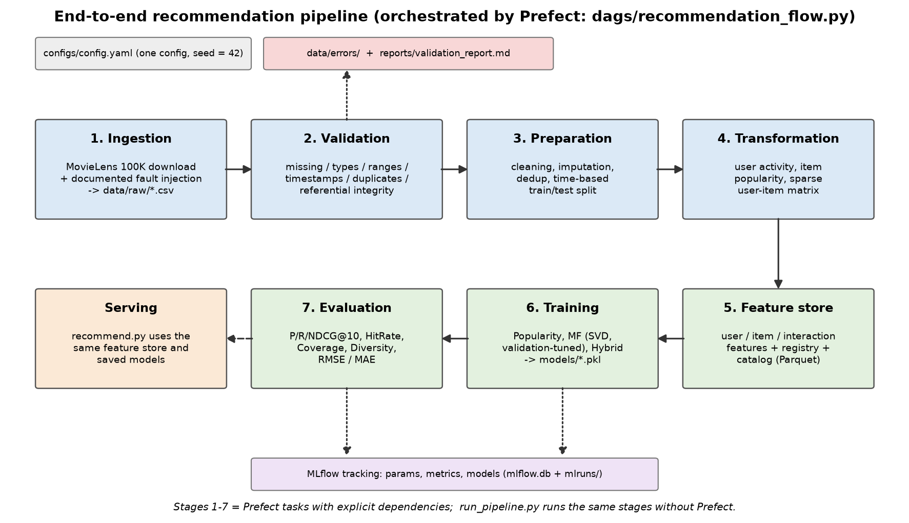

# End-to-End Data Management Pipeline for a Movie Recommendation System

DM4ML Assignment 2 — an end-to-end, reproducible pipeline that ingests the **MovieLens 100K** dataset,
validates and prepares it, builds a reusable feature store, trains and evaluates three recommenders with
**MLflow** tracking, and orchestrates everything with **Prefect**.

```
Ingestion → Validation → Preparation → Transformation → Feature store → Training → Evaluation
                          (all orchestrated as one Prefect flow with explicit task dependencies)
```



## Tech stack

| Concern | Tool |
|---|---|
| Language / data | Python 3.12, pandas, NumPy, SciPy (sparse matrices) |
| Storage | CSV (raw), Parquet via pyarrow (processed data and features) |
| Validation | Rule-based validation module (`src/validation`) with an error dataset and a report |
| Feature management | Custom file-based feature store with a registry and catalog (`src/features`) |
| Models | Popularity baseline, matrix factorization (truncated SVD, scikit-learn), hybrid |
| Experiment tracking | MLflow (SQLite backend `mlflow.db`, artifacts in `mlruns/`) |
| Orchestration | Prefect 3 flow (`dags/recommendation_flow.py`) + plain runner (`run_pipeline.py`) |

## Project structure

```
recommendation-pipeline/
├── configs/config.yaml          # single source of truth for paths, seed, thresholds, model params
├── dags/recommendation_flow.py  # Prefect flow (the DAG) + optional daily schedule
├── run_pipeline.py              # same pipeline without Prefect (choose stages with --stages)
├── recommend.py                 # serving CLI: top-K recommendations for a user
├── scripts/architecture_diagram.py
├── src/
│   ├── ingestion/               # download MovieLens / synthetic fallback, fault injection
│   ├── validation/              # rule-based checks -> valid data + data/errors/
│   ├── preparation/             # cleaning, imputation, dedup, time-based split
│   ├── transformation/          # user activity, item popularity, user-item matrix
│   ├── features/                # feature store, registry, catalog
│   ├── training/                # models + training with MLflow
│   ├── evaluation/              # metrics + evaluation report
│   ├── tracking.py              # MLflow setup
│   └── utils.py                 # config, logging, I/O helpers
├── data/{raw,processed,features,errors}/
├── models/                      # pickled models + model_registry.json
├── reports/                     # validation report, feature catalog, results, diagram
└── logs/pipeline.log
```

## Setup

Requires **Python 3.10–3.12** (developed on 3.12.16, macOS).

```bash
git clone <this-repo-url>
cd recommendation-pipeline
python3.12 -m venv .venv
source .venv/bin/activate          # Windows: .venv\Scripts\activate
pip install --upgrade pip
pip install -r requirements.txt
```

## Running the pipeline

**Option A — Prefect flow (recommended):**
```bash
python dags/recommendation_flow.py
```
To see the run graph in the Prefect UI, start a server in a second terminal and point the client at it:
```bash
prefect server start                                          # terminal 2 -> http://127.0.0.1:4200
prefect config set PREFECT_API_URL=http://127.0.0.1:4200/api  # terminal 1, once
python dags/recommendation_flow.py
```
Schedule it daily at 02:00 with `python dags/recommendation_flow.py --serve`.

**Option B — plain Python:**
```bash
python run_pipeline.py                         # all stages
python run_pipeline.py --stages train evaluate # selected stages (dependency order is kept)
```

**Single stages** (each reads the previous stage's outputs):
```bash
python -m src.ingestion.ingest
python -m src.validation.validate
python -m src.preparation.prepare
python -m src.transformation.transform
python -m src.features.feature_store
python -m src.training.train
python -m src.evaluation.evaluate
```

**Recommendations for a user** (uses the same feature store as training):
```bash
python recommend.py --user 1
python recommend.py --user 4 --model popularity --k 5
```

**Metric sanity tests:**
```bash
python -m tests.test_metrics
```

**MLflow UI:**
```bash
mlflow ui --backend-store-uri sqlite:///mlflow.db --port 5001   # http://127.0.0.1:5001
```
(port 5001 because macOS uses 5000 for AirPlay)

Offline? Set `ingestion.source: synthetic` in `configs/config.yaml` to generate data in the MovieLens
format instead of downloading it.

## Pipeline stages

| # | Stage | What it does | Main outputs |
|---|---|---|---|
| 1 | Ingestion | Downloads MovieLens 100K (943 users, 1,682 movies, 100,000 ratings); stores raw tables as text; injects 67 documented faulty records to exercise validation | `data/raw/*.csv`, `ingestion_manifest.json` (row counts and MD5 checksums), `injected_faults_manifest.csv` |
| 2 | Validation | Missing values, data types, rating range 1–5, timestamp range (≥ 1995, not in the future), exact duplicates, user/item duplicates, age/gender rules, referential integrity | `data/processed/validated_*.parquet`, `data/errors/*_errors.csv` (with `error_reason`), `reports/validation_report.md` |
| 3 | Preparation | Standardizes text fields, adds age groups, parses release dates and imputes the missing year (median), keeps the latest rating per user–item pair, **global time-based split** (first 80% of time → train) | `train`, `test`, `*_clean`, `split_info.json` |
| 4 | Transformation | From training data only: user activity summary, item popularity (incl. Bayesian average), sparse 943 × 1682 user–item matrix | `user_activity_summary`, `item_popularity`, `user_item_matrix.npz` |
| 5 | Features | User, item and interaction features computed as of the cutoff; registry + catalog; `FeatureStore` read API shared by training and serving | `data/features/*`, `reports/feature_catalog.md` |
| 6 | Training | Tunes MF latent factors on a validation slice (last 10% of the training period), trains 3 models, logs everything to MLflow | `models/*.pkl`, `models/model_registry.json`, MLflow runs |
| 7 | Evaluation | Precision/Recall/NDCG/HitRate@10, catalogue coverage, intra-list genre diversity, RMSE/MAE; overall and by warm vs cold-start users | `reports/evaluation_results.{md,csv,json}`, `reports/model_comparison.png` |

## Models

* **Popularity (baseline):** ranks movies by number of positive (≥ 4) training ratings; rating prediction = Bayesian item mean.
* **Matrix factorization:** truncated SVD of the user × item matrix for ranking (n_factors chosen from {10, 20, 50, 100} by validation NDCG@10); rating head = global mean + regularized user/item biases + SVD of residuals. Cold-start users fall back to popularity.
* **Hybrid:** `0.7 · MF + 0.2 · user–genre match + 0.1 · popularity` for known users. Cold-start users get popularity nudged by their gender × age-group segment's genre affinity, a feature from the feature store.

## Results (MovieLens 100K, K = 10, 290 test users: 98 warm, 192 cold-start)

| Model | Precision@10 | Recall@10 | NDCG@10 | HitRate@10 | Coverage | Diversity | RMSE | MAE |
|---|---|---|---|---|---|---|---|---|
| Popularity (baseline) | 0.2448 | 0.0831 | 0.2706 | 0.7103 | 0.0440 | 0.6955 | 1.0292 | 0.8296 |
| Matrix Factorization (SVD) | 0.2424 | 0.0815 | 0.2706 | 0.7069 | 0.1778 | 0.7019 | 1.0235 | 0.8226 |
| Hybrid (MF + features) | 0.2431 | 0.0813 | 0.2707 | 0.7172 | 0.1623 | 0.6389 | 1.0235 | 0.8226 |

Full tables, including the warm / cold-start breakdown: [`reports/evaluation_results.md`](reports/evaluation_results.md).

## Reproducibility

* One config file and one seed (`42`) for every stage; fixed `random_state` in SVD.
* Time-based split and validation slice: no information from the test period is used for features or tuning.
* Ingestion records MD5 checksums of the raw data; the feature registry records the feature-set version and cutoff.
* Every training run's parameters, metrics, model file, config and feature registry are stored in MLflow.
* Rerunning the flow reproduces identical metrics.

## Deliverables in this repository

| Deliverable | Location |
|---|---|
| Source code (modular) | `src/`, `dags/`, `run_pipeline.py`, `recommend.py` |
| Setup and run instructions | this README |
| Dependencies | `requirements.txt` |
| Architecture diagram | `reports/architecture.png` |
| Data validation report / logs | `reports/validation_report.md`, `data/errors/`, `logs/pipeline.log` |
| Feature catalog | `reports/feature_catalog.md` |
| Model evaluation results | `reports/evaluation_results.md`, `reports/model_comparison.png` |
| Orchestration DAG + run screenshot | `dags/recommendation_flow.py`, `reports/screenshots/` |
| Final report | `reports/final_report.pdf` |
